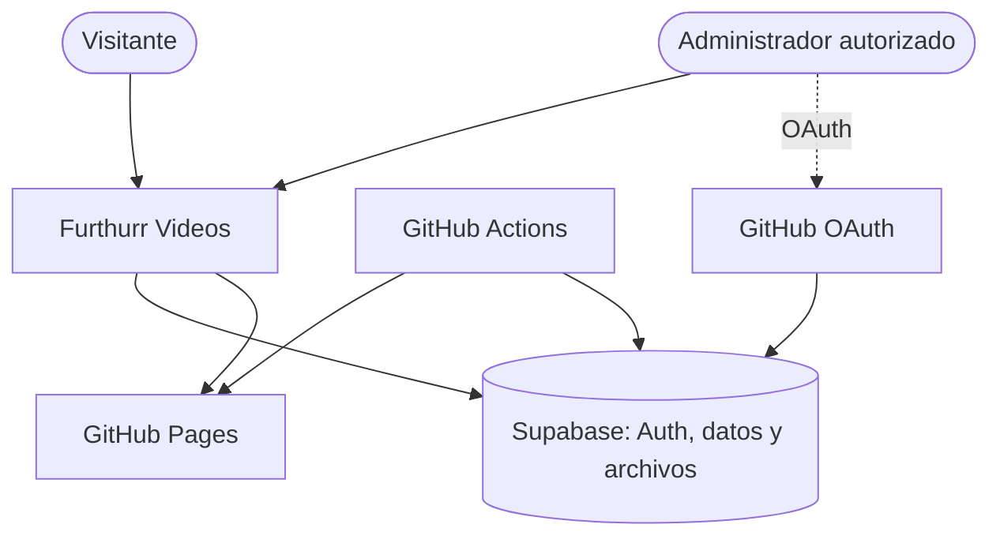
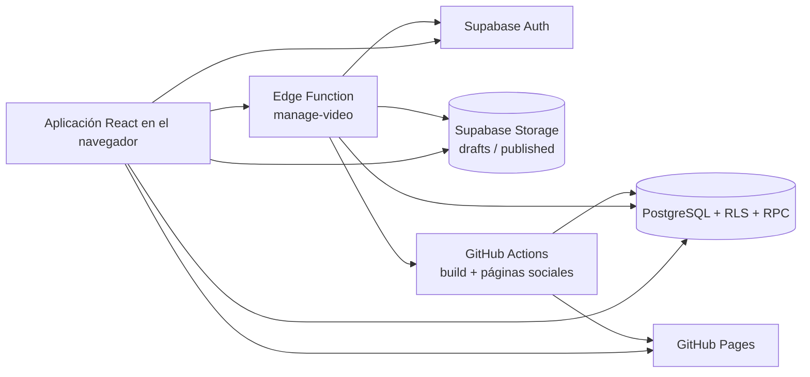
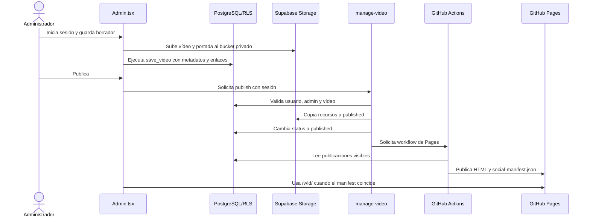

# Arquitectura — Furthurr Videos

Documentación canónica de la arquitectura. Léela antes de trabajar en el proyecto.

## Estado de sincronización

- Tecnología detectada: React 19 + TypeScript + Vite; Supabase Auth, PostgreSQL, Storage y Edge Functions; GitHub Actions + GitHub Pages.
- Modo: `lite`.
- Último commit documentado: `f8a57bcfd635d717e5f4631a7b194b8381dd4b27`.
- Última actualización: 2026-11-02.
- Alcance de la inspección: árbol de trabajo actual, incluidos los cambios locales.
- Estado: la marca apunta a `HEAD`, pero hay cambios relevantes sin commit en `README.md`, `e2e/admin.spec.ts`, `src/lib.ts`, `src/pages/Admin.tsx` y `supabase/functions/manage-video/index.ts`. No se puede demostrar sincronización completa con Git hasta establecer un nuevo baseline.

## Contexto para IA

- **Qué es el sistema:** biblioteca pública de vídeos WebM y MP4 con administración privada. El visitante consulta publicaciones desde una aplicación React; un administrador autenticado carga borradores, edita metadatos y publica recursos mediante Supabase.
- **Estilo arquitectónico:** aplicación web estática con backend gestionado y publicación híbrida. La vista dinámica `/watch/` permite consultar una publicación sin esperar un build; GitHub Actions genera las páginas `/v/<id>/` y sus metadatos sociales.
- **Capas y límites:** la presentación vive en `src/main.tsx`, `src/pages/Admin.tsx` y `src/styles.css`; la integración cliente y los tipos compartidos viven en `src/lib.ts` y `src/poster.ts`; la persistencia, RLS, RPC y almacenamiento viven en `supabase/migrations/`; las operaciones privilegiadas viven en `supabase/functions/manage-video/`; la generación y el despliegue viven en `scripts/` y `.github/workflows/`.
- **Puntos de entrada:** `src/main.tsx:507` selecciona la vista pública, la vista de reproducción o el panel administrativo según la URL. `supabase/functions/manage-video/index.ts:94` atiende las operaciones administrativas. `scripts/generate-pages.mjs:5` genera el artefacto estático posterior al build.
- **Decisión clave:** la publicación combina una URL dinámica inmediata con páginas estáticas que se consideran listas cuando `social-manifest.json` coincide con `updated_at`; está documentada en [ADR 0001](decisions/0001-publicacion-hibrida-estatica-dinamica.md).

### Mapa de responsabilidades

| Ubicación | Responsabilidad | Dependencias principales |
| --- | --- | --- |
| `src/main.tsx` | Shell, biblioteca pública, reproducción y composición de rutas | `src/lib.ts`, React, Supabase |
| `src/pages/Admin.tsx` | Login GitHub, edición, carga, publicación y estado de despliegue | `src/lib.ts`, Supabase Auth/RPC/Functions |
| `src/lib.ts` | Cliente Supabase, modelo `Video`, formatos, URLs y operaciones remotas | `@supabase/supabase-js`, variables `VITE_*` |
| `src/styles.css` | Tokens visuales, componentes CSS, responsive y foco visible | Ninguna dependencia de ejecución |
| `supabase/migrations/` | Tablas, restricciones, RLS, RPC y buckets | PostgreSQL, Supabase Storage |
| `supabase/functions/manage-video/` | Autorización del administrador, copia/eliminación de objetos y solicitud de Pages | Supabase Auth, service role, GitHub API |
| `scripts/generate-pages.mjs` | Generación de rutas, metadatos y manifiesto social | REST público de Supabase, `scripts/social.mjs` |
| `.github/workflows/pages.yml` | Verificación, build y publicación en GitHub Pages | npm, Vitest, Playwright, GitHub Pages |

### Reglas de dependencia

1. El navegador usa únicamente la clave pública de Supabase expuesta mediante variables `VITE_*`; las credenciales privilegiadas permanecen en Supabase.
2. La UI usa `src/lib.ts` para operaciones compartidas. La publicación, retirada, borrado y consulta del estado de despliegue pasan por `manage-video`.
3. La base de datos y sus triggers son la autoridad para las restricciones de vídeos, rutas de almacenamiento y estados de publicación. La Edge Function no sustituye esas garantías.
4. El bucket `drafts` es privado y el bucket `published` es público; la Edge Function es el único componente que copia recursos al bucket publicado.
5. El generador de páginas solo consume publicaciones visibles y escribe en `dist/`; `dist/` es un artefacto de build, no una fuente de datos.
6. Los tests y el workflow validan el producto, pero no deben convertirse en fuentes alternativas de configuración o modelo.

## Modelo C4

### C1 — Contexto

El visitante consulta la biblioteca y reproduce archivos publicados. El administrador inicia sesión con GitHub y opera sobre borradores. Supabase concentra identidad, autorización, datos y almacenamiento. GitHub Actions construye y publica el sitio estático; durante el build consulta las publicaciones visibles.

### C2 — Contenedores

### Flujo de publicación

## Restricciones y riesgos arquitectónicos

- La disponibilidad de las páginas sociales depende de GitHub Actions y de que el build pueda leer Supabase. La URL dinámica de reproducción reduce el impacto de esa dependencia.
- La publicación de archivos está separada de la escritura de metadatos: el trigger de PostgreSQL impide cambiar recursos de una publicación sin retirarla, mientras la Edge Function coordina la copia entre buckets.
- GitHub Pages es un destino estático. Los cambios de datos publicados aparecen inmediatamente en `/watch/`, pero las páginas sociales requieren un despliegue posterior.
- El árbol de trabajo contiene cambios locales relevantes. Esta documentación refleja esas fuentes, pero su marca Git solo representa `HEAD`.

## Deuda técnica

| Severidad | Hallazgo | Ubicación | Impacto | Esfuerzo | Recomendación |
| --- | --- | --- | --- | --- | --- |
| 🟡 Media | La composición de la aplicación pública y el enrutado por `location` están concentrados en un único punto de entrada. | `src/main.tsx:21-520` | Aumenta el coste de modificar una vista sin introducir efectos colaterales. | Medio | Separar rutas y vistas cuando crezca el número de pantallas, conservando `App` como composición. |
| 🟡 Media | El panel administrativo concentra autenticación, carga, edición, publicación y seguimiento del despliegue. | `src/pages/Admin.tsx:18-504` | Dificulta probar y evolucionar cada flujo de forma aislada. | Medio | Extraer hooks o módulos por caso de uso cuando el panel incorpore nuevas operaciones. |
| 🟢 Baja | La marca documental no puede verificar todavía los cambios locales frente a un commit. | Estado Git del proyecto | Un agente puede consumir un contexto que no corresponda exactamente a `HEAD`. | Bajo | Crear un baseline Git después de revisar los cambios locales y volver a sincronizar la documentación. |

## Fuentes canónicas

- Código de entrada y vistas: `src/main.tsx`, `src/pages/Admin.tsx`.
- Contrato cliente y operaciones remotas: `src/lib.ts`.
- Esquema y controles de datos: `supabase/migrations/202610290001_initial.sql` y `supabase/migrations/202611020001_allow_mp4.sql`.
- Operaciones administrativas: `supabase/functions/manage-video/index.ts`.
- Build y despliegue: `scripts/generate-pages.mjs` y `.github/workflows/pages.yml`.
- Dependencias y comandos: `package.json`.
