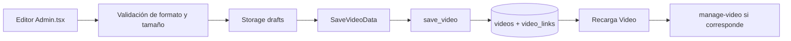

# Mapeo entre formulario, API, persistencia y dominio

No existe un mapper formal. El proyecto conserva los nombres snake_case de PostgreSQL en el tipo `Video` y construye payloads explícitos para los RPCs.

## Formulario administrativo → Storage → RPC

1. El editor calcula un UUID de vídeo y una ruta con prefijo `<USER_ID>/<VIDEO_UUID>/`.
2. El vídeo se valida como WebM o MP4, con máximo de 40 MiB, y se sube a `drafts`.
3. La portada cargada o extraída se convierte a JPG, PNG o WebP y se sube a `drafts`.
4. El formulario crea `p_data` con título, descripción, etiquetas, rutas y duración, y `p_links` como array de enlaces.
5. `save_video` inserta o actualiza `videos`, borra los enlaces anteriores y vuelve a insertar `video_links`.
6. Si el vídeo ya estaba publicado, una portada nueva se procesa como `replace-poster`; los archivos de vídeo no se reemplazan mientras la publicación esté abierta.

Fuentes: `src/pages/Admin.tsx:404-516`, `src/lib.ts:71-85` y `supabase/migrations/202610290001_initial.sql:78-93`.

## Fila PostgreSQL → `Video`

| Origen | Destino | Transformación |
| --- | --- | --- |
| `videos.id` | `Video.id` | UUID serializado como string. |
| `videos.title`, `description`, `tags` | Campos homónimos | Sin transformación de nombre. El formulario recorta título y descripción y procesa etiquetas antes del RPC. |
| `videos.video_path`, `poster_path` | Campos homónimos | Se conservan como rutas de Storage; no son URLs públicas. |
| `videos.duration` | `Video.duration` | Número de segundos o `null`. |
| `videos.status`, `published_at`, `updated_at`, `created_at` | Campos homónimos | Timestamps se reciben como strings ISO. |
| Relación `video_links` | `Video.video_links` | Se incluye solo en consultas con `select=*,video_links(*)`. |

Fuentes: `src/lib.ts:19-31`, `src/main.tsx:152-158` y `src/pages/Admin.tsx:68-75`.

## Fila publicada → URL de Storage

`asset(path, published)` convierte una ruta en URL pública mediante el cliente de Storage. Para una publicación, el bucket elegido es `published`; para una previsualización de borrador, el panel solicita una URL firmada directamente sobre `drafts`.

- Publicado: `storage.from("published").getPublicUrl(path)`.
- Borrador: `storage.from("drafts").createSignedUrl(path, 3600)`.
- La ruta nunca se concatena desde una entrada arbitraria sin las validaciones de base de datos o Edge Function.

Fuentes: `src/lib.ts:35-39` y `src/pages/Admin.tsx:300-305`.

## `Video` → vista pública

- `Library` recibe una lista de `Video` publicados y construye tarjetas con portada, título, etiquetas, duración y fecha.
- `Watch` obtiene un único `Video` publicado, genera la URL pública del vídeo y muestra enlaces.
- La ruta se obtiene desde query string `/watch/?v=<id>` o `/v/<id>/`; no se hace una segunda conversión del modelo.

Fuentes: `src/main.tsx:140-301`, `src/main.tsx:302-506` y `src/lib.ts:40-68`.

## Publicación → manifiesto social

1. `generate-pages.mjs` consulta solo `id`, `title`, `description`, `poster_path` y `updated_at`.
2. `social.mjs` convierte el registro en HTML escapado con título, descripción, canonical y Open Graph.
3. El generador escribe `/v/<id>/index.html` y añade `<id>: <updated_at>` a `social-manifest.json`.
4. `socialReady` compara el timestamp del manifiesto con el del `Video` vivo.
5. `shareUrl` devuelve la URL estática solo cuando coinciden; si no, devuelve `/watch/?v=<id>`.

Fuentes: `scripts/generate-pages.mjs:24-69`, `scripts/social.mjs:1-67` y `src/lib.ts:86-103`.

## Errores API → estado de UI

- Errores del SDK de Auth, PostgREST o Storage se convierten en mensajes de estado del panel.
- `manageVideo` evita propagar el cuerpo técnico del error de la Function y usa un mensaje genérico para fallos de invocación; si la Function devuelve `data.error`, muestra ese mensaje funcional.
- Fallos al leer el manifiesto no bloquean la reproducción: solo fuerzan la URL dinámica.
- Fallos del build al consultar publicaciones abortan el despliegue para evitar publicar un conjunto incompleto.

Fuentes: `src/lib.ts:105-117`, `src/pages/Admin.tsx:512-516` y `scripts/generate-pages.mjs:35-45`.
