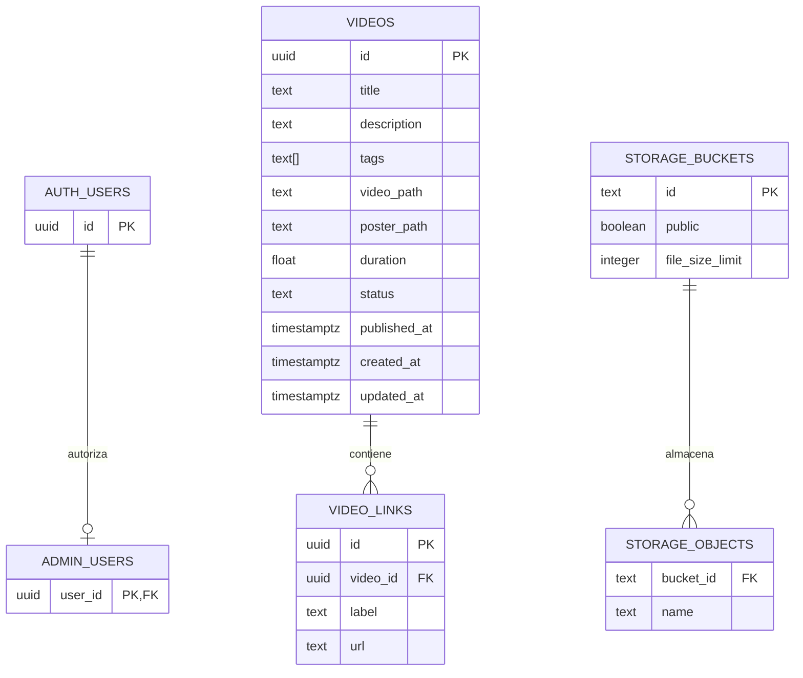

# Esquema de datos y persistencia

La persistencia del producto vive en PostgreSQL y Storage gestionados por Supabase. Las migraciones versionadas son la fuente de verdad del esquema. El siguiente diagrama simplifica las tablas externas de Auth y Storage para mostrar sus relaciones relevantes.

## Diagrama ER

`AUTH_USERS`, `STORAGE_BUCKETS` y `STORAGE_OBJECTS` pertenecen al esquema gestionado de Supabase. El código de este proyecto solo define la configuración, políticas y uso de esos recursos.

## Tablas del proyecto

### `public.admin_users`

- `user_id uuid primary key references auth.users(id) on delete cascade`.
- No concede permisos por registro OAuth; un operador debe autorizar el UUID explícitamente.
- RLS habilitado y sin privilegios directos de lectura/escritura para `anon` o `authenticated`.
- `is_admin()` usa esta tabla con `security definer` y `search_path = ''`.

### `public.videos`

- `id uuid primary key default gen_random_uuid()`.
- `title`: obligatorio, longitud recortada entre 1 y 160.
- `description`: obligatorio, valor por defecto vacío, máximo 10.000.
- `tags`: `text[]`, máximo 12 elementos; el trigger limita cada etiqueta a 1-40 caracteres.
- `video_path` y `poster_path`: obligatorios; el trigger exige que sus dos primeros segmentos correspondan al usuario y al vídeo.
- `duration`: `double precision` no negativa y finita.
- `status`: solo `draft` o `published`, por defecto `draft`.
- `published_at`: puede ser nulo en borrador y es obligatorio en publicado.
- `created_at` y `updated_at`: timestamps; `updated_at` se actualiza en el trigger.
- Índice `videos_publication(status, published_at desc, id)` para el listado público.

### `public.video_links`

- `id uuid primary key default gen_random_uuid()`.
- `video_id` referencia `videos(id)` con `on delete cascade`.
- `label`: 1-100 caracteres.
- `url`: patrón `http://` o `https://`, sin espacios, máximo 2.048 caracteres.
- Índice `video_links_parent(video_id)`.

Fuente de verdad: `supabase/migrations/202610290001_initial.sql:15-37`.

## RLS y permisos

- `videos`: visitantes pueden leer publicaciones; administradores pueden leer contenido y editar metadatos; el borrado directo está revocado.
- `video_links`: visitantes pueden leer enlaces de un vídeo visible; administradores pueden gestionarlos.
- `admin_users`: no es consultable directamente por clientes.
- `storage.objects` en `drafts`: un administrador solo lee, sube y elimina objetos cuyo primer segmento sea su propio UUID.
- `storage.objects` en `published`: no tiene políticas de carga pública; la Edge Function usa el service role para copiar recursos.

Fuente de verdad: `supabase/migrations/202610290001_initial.sql:1-14` y `supabase/migrations/202610290001_initial.sql:39-107`.

## Funciones y triggers

### `public.is_admin()`

Función estable con `security definer` que devuelve si `auth.uid()` existe en `admin_users`. Se concede ejecución a `anon` y `authenticated`, pero no acceso directo a la tabla.

### `public.guard_video_update()` y trigger `guard_video`

- Impide cambiar `status` o `published_at` directamente desde una actualización normal.
- Impide cambiar las rutas de un vídeo publicado sin retirarlo.
- Valida el prefijo de las rutas y la longitud de cada etiqueta.
- Actualiza `updated_at` con `clock_timestamp()`.

### `public.save_video(p_id, p_data, p_links)`

- Requiere `is_admin()`.
- Rechaza listas de enlaces no array o con más de 20 elementos.
- Inserta o actualiza los campos de `videos`.
- Elimina y vuelve a insertar la colección de `video_links`.

Fuente de verdad: `supabase/migrations/202610290001_initial.sql:7-14` y `supabase/migrations/202610290001_initial.sql:56-95`.

## Buckets y migraciones

- `drafts`: privado, límite inicial 40 MiB.
- `published`: público, límite inicial 40 MiB.
- Tipos iniciales: vídeo WebM e imágenes JPEG/PNG/WebP.
- La migración posterior añade `video/mp4` a ambos buckets.

Fuentes: `supabase/migrations/202610290001_initial.sql:97-107` y `supabase/migrations/202611020001_allow_mp4.sql:1-4`.
